<div align="center">

# AlgoPeer

### 算法课程作业与跨班评审平台

编程练习 · 微课项目 · 跨班匿名评审 · 可信成绩 · AI 辅助

[用户手册](docs/用户手册.md) · [算法设计](docs/算法设计.md) · [部署指南](docs/部署与运维.md)

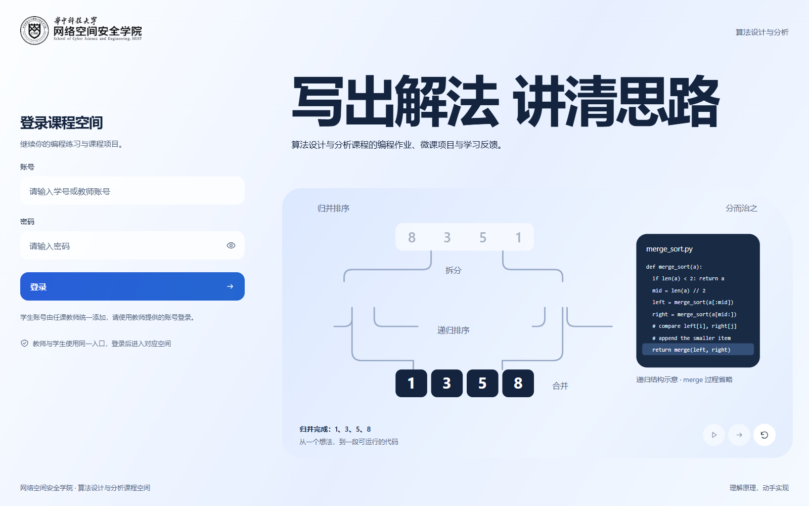

</div>

AlgoPeer 面向《算法设计与分析》课程，把作业发布、学生提交、自动判题、匿名评阅、教师复核和成绩反馈连成完整流程。学生围绕代码、证明和微课展示算法；教师结合原始材料、同伴评分与模型证据完成教学评阅。

系统的核心是 **跨班约束分配 + 稀疏贝叶斯聚合 + 教师证据复核**：每份期末作品由对方班五名不同学生评阅，模型校准评分尺度并识别异常，最终成绩保留清楚的形成依据。

| 课程活动 | 系统支持 |
| --- | --- |
| 编程练习 | C++17 自动判题、编译反馈、提交历史、结合代码版本的 AI 助教 |
| 算法分析、证明与开放问答 | 在线作答、提交即完成、历次版本查阅 |
| 期末微课 | 按大章与知识点选题，上传 PPT、讲解视频、源码和测试材料 |
| 跨班匿名评审 | 公平分配、逐项量表、评分修改留痕、缺评替补、异常证据与最终复核 |
| 教学与学习 | 26 个课程选题、学习统计、成绩导出、知识点 AI 学习与教学建议 |

## 页面一览

### 学生完成作业，教师评阅材料

| 学生课程空间 | 教师评分工作台 |
| :---: | :---: |
| [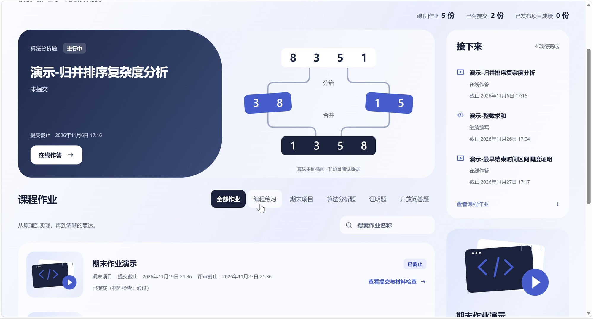](docs/images/student-workspace.jpg) | [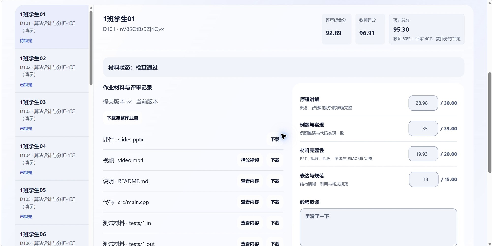](docs/images/teacher-review.jpg) |
| 按题型寻找作业，查看状态与下一步操作 | 材料、教师分、同伴聚合与最终分对应呈现 |

### 从编程实现到在线推导

| 编程与自动判题 | 算法分析在线作答 |
| :---: | :---: |
| [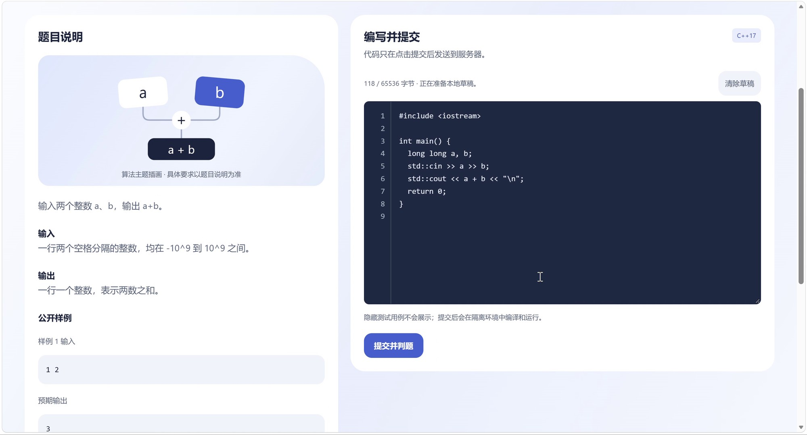](docs/images/programming.jpg) | [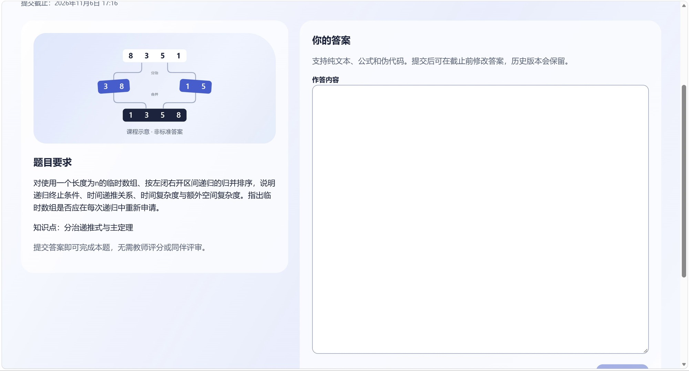](docs/images/online-answer.jpg) |
| 题面与编辑器并列，保留判题与代码历史 | 直接提交推导和解释，保留历次答案 |

页面截图取自运行中的系统及项目组实际演示录像，点击可查看大图。录像中的期末作业使用教师 50% / 同伴 50% 权重；系统默认值为 60% / 40%，可在作业发布前设置。

## 跨班评审算法

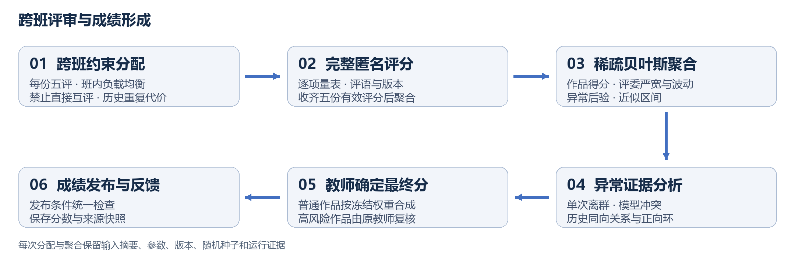

### 1. 用联合整数规划决定谁来评

两个班交叉评阅，在同一个 0–1 混合整数规划中同时求解两个方向。分配必须满足：

- 每份作品恰好获得 **五名不同的跨班评委**。
- 首次分配时，同班评委任务量差最多为 **1**。
- 本轮禁止两位作者直接互相评阅。
- 优先减少历史重复配对，再以固定随机种子扰动区分同代价方案。

例如两班分别为 100 人和 40 人、每人提交一份作品时，总计形成 **700 条评审任务**：大班每人评 2 份，小班每人评 12～13 份。教师先预览实际负载，再确认分配。新增作品采用增量算法，固定已发出的任务，以累计负载平方和优先分散新任务。

### 2. 在稀疏评分图上校准分数

不同作品拥有不同的五名评委，模型沿实际评分关系计算。归一化后，同时估计作品逐项得分、评委严宽偏差、评分噪声和单次异常概率。当前实现采用高斯密度与均匀异常密度的混合近似，进行确定性 MAP-EM 更新。

$$
w_{rsk}=\frac{1-p_{rsk}}{\max(\sigma_r^2,\sigma_{\min}^2)}
$$

其中 $p_{rsk}$ 是单次异常后验概率，$\sigma_r$ 是评委评分噪声。模型以该有效权重更新作品分；评委完成至少 **三份不同作品**后学习个人参数，样本较少时使用群体先验。逐项近似区间、原始五人分和中位数同时保留，帮助教师解释结果。

### 3. 把异常转化为具体证据

系统识别四人接近而一人极端偏离、异常后验较高、模型与中位数冲突、区间过宽等情况，并结合历史校准残差检查持续抬分、压分及正向关系环。

**普通作品**按发布时冻结的教师 / 同伴权重合成。**高风险作品**由初评的同一位教师查看第一次教师分、五人原始分、聚合结果和异常证据，再录入一个复核最终分。

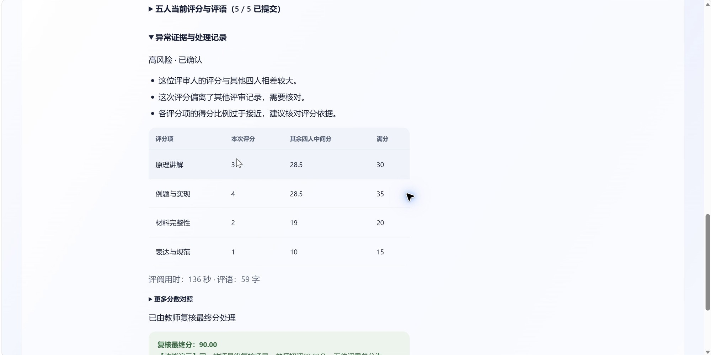

发布前统一检查五份完整有效评分、成功聚合、教师锁分与异常处理状态，随后保存最终成绩和来源快照。即使同伴权重为 0%，每份作品仍需完成五评。

### 可复现实验

以 10∶10、100∶40、120∶40 三种班级规模，各运行种子 41、42、43。九次首次分配均满足每份五评、零直接互评和班内负载差不超过 1。聚合对比使用带真实潜在分数的模拟数据；下表为九次运行的 MAE 均值，单位为百分制分数。

| 方法 | 正常评分 | 含 10% 异常评分 |
| --- | ---: | ---: |
| 算术平均 | 1.955 | 6.967 |
| 中位数 | 2.700 | 3.862 |
| 去极值平均 | 2.315 | 4.572 |
| **稀疏贝叶斯** | **1.263** | **2.147** |

实验真值来自 U(40,90)，评委偏差为班内中心化的 U(−10,10)，正常噪声标准差为 3；异常评分以 10% 概率替换为 5 或 98。[实验程序](algorithm/experiments/sparse_review.py)与[本次原始结果](algorithm/experiments/results/20261030.json)可直接复核。模型公式、推导、复杂度及含标准差的完整结果见本地交付的系统介绍与算法设计文档。

研究依据包括 [PeerReview4All（JMLR 2021）](https://jmlr.org/papers/v22/20-190.html)、[受约束随机评审分配（NeurIPS 2020）](https://proceedings.neurips.cc/paper/2020/hash/93fb39474c51b8a82a68413e2a5ae17a-Abstract.html)与[贝叶斯同伴评分（AAAI 2023）](https://ojs.aaai.org/index.php/AAAI/article/view/25757)。论文思想与本项目具体规则的对应关系见[算法设计](docs/算法设计.md)，逐项公式与数值参数见[实现规格](algorithm/ALGORITHM_SPEC.md)。

## AI 辅助特色

AI 围绕当前课程内容提供帮助：正在写的代码、选定的知识点、当前班级统计，以及被评阅作品的视频证据。

| 编程助教 | 知识点学习 |
| :---: | :---: |
| [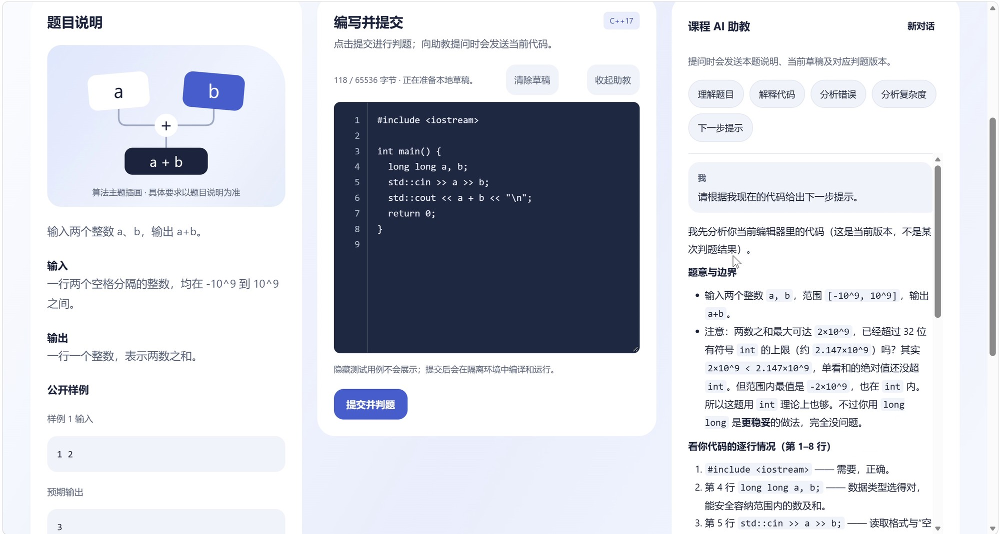](docs/images/ai-programming.jpg) | [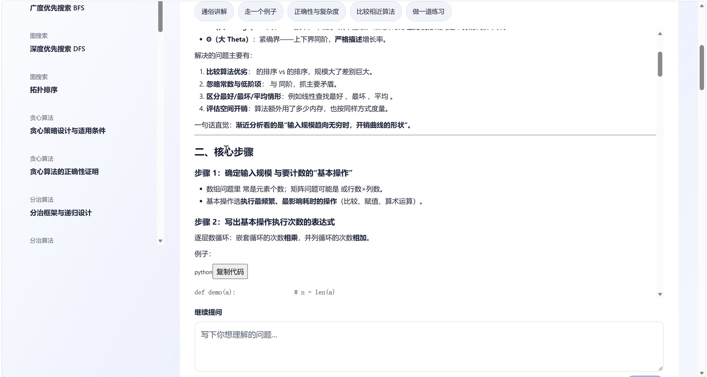](docs/images/ai-knowledge.jpg) |
| 对应当前草稿、选中片段或本人判题版本分析问题 | 沿课程目录追问概念、例题、证明和复杂度 |

| 特色 | 具体能力 |
| --- | --- |
| 结合版本的编程辅导 | 区分当前草稿与判题版本，围绕实际代码解释错误和改进方向 |
| 连续的知识点学习 | 按知识点保存对话，支持数学公式、表格和可复制代码 |
| 根据课堂证据提出教学建议 | 结合当前班级通过情况、常见错误与知识点统计安排复习练习 |
| 带时间点证据的视频评阅 | 覆盖完整讲解视频，汇总内容与逐项建议，点击时间点回看原材料 |

文字助教与视频模型由教师分别配置；AI 建议独立保存，教师通过正式评分流程确定分数。具体用法、上下文、配额与配置方式见 [AI 辅助特色](docs/AI辅助特色.md)。

## 安全加固

| 保护层面 | 已实现措施 |
| --- | --- |
| 身份与会话 | scrypt 带盐密码哈希、JWT 与服务端会话校验、改密撤销旧会话、登录频率限制 |
| 对象权限与匿名 | 逐次检查角色、班级、提交和评委任务归属，原始材料与匿名材料分开保存 |
| 上传检查 | ZIP 路径穿越、符号链接、解压体积与压缩比检查，Office 内层危险内容检查 |
| 代码执行 | 无网络、非 root、只读根目录与资源限制，独立私有判题目录 |
| 请求与页面 | 时间戳与一次性 nonce 防重放、频率限制、可信来源、CSP 与受控内容渲染 |
| 凭据与成绩 | 模型密钥服务器加密，评分版本、权重冻结、锁分、发布条件与来源快照 |

部署配置和 AI 调用数据范围见[安全与隐私](docs/安全与隐私.md)。

## 完整使用流程


| 匿名量表评分 | 成绩统计与导出 |
| :---: | :---: |
| [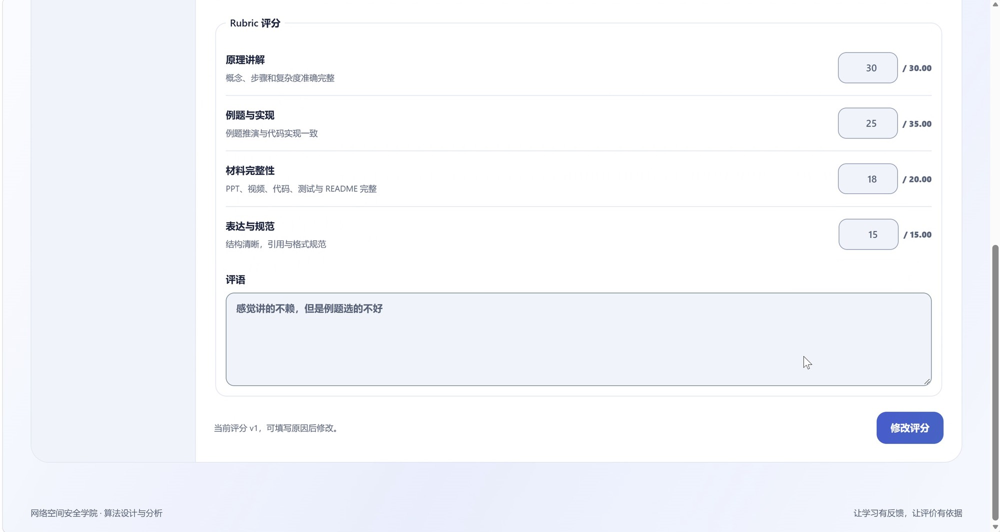](docs/images/peer-review.jpg) | [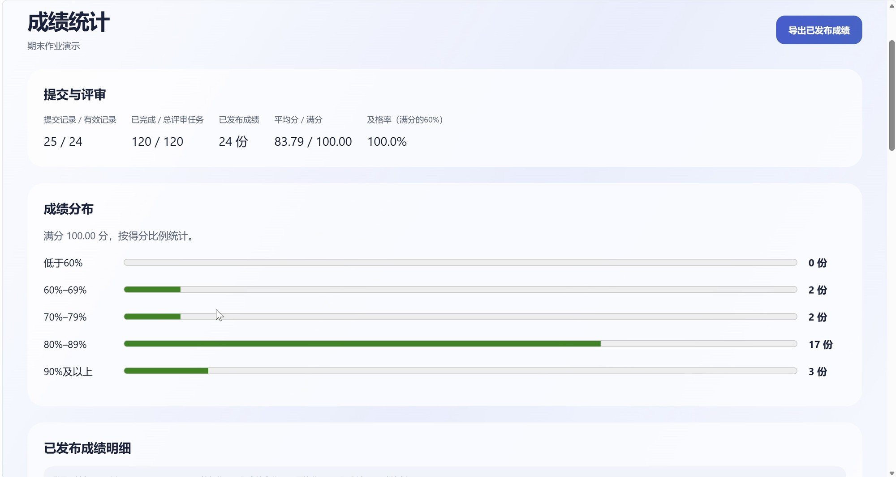](docs/images/grade-feedback.jpg) |

逐步操作见[用户手册](docs/用户手册.md)。

<details>
<summary>查看更多实际页面：材料上传、分配预览、发布结果与教学建议</summary>

| 材料上传 | 跨班分配预览 |
| :---: | :---: |
| [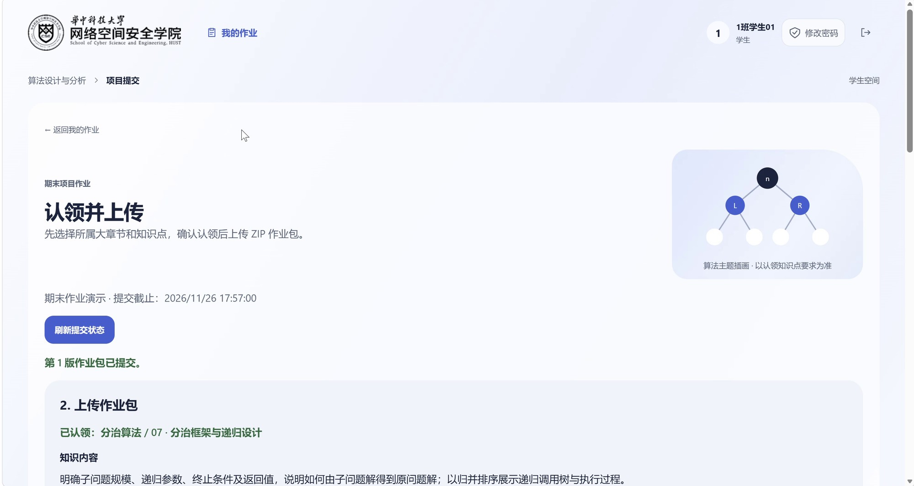](docs/images/project-submission.jpg) | [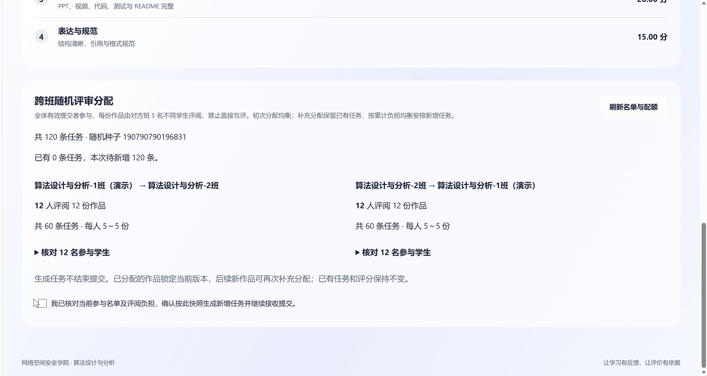](docs/images/allocation-preview.jpg) |

| 成绩发布结果 | AI 教学建议 |
| :---: | :---: |
| [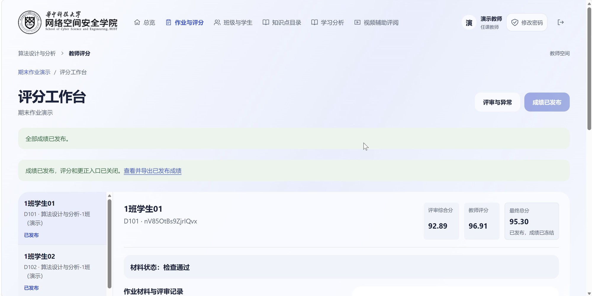](docs/images/grade-published.jpg) | [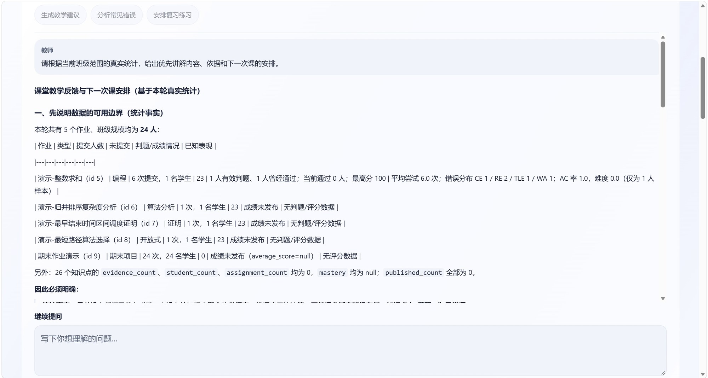](docs/images/ai-teaching.jpg) |

</details>

## 本地运行

准备 Docker Compose、Node.js 20 或更高版本。在仓库根目录复制配置并启动服务：

```powershell
Copy-Item .env.example .env
# 编辑 .env，设置数据库密码、独立的 JWT_SECRET 和 INTERNAL_API_TOKEN。
docker compose up -d --build
docker compose exec backend python scripts/seed_demo.py
```

在另一个终端启动前端：

```powershell
cd frontend
npm ci
npm run dev
```

打开[本地登录页](http://localhost:5173/login)。初始化脚本为本地体验创建以下演示账号：

| 身份 | 账号 | 初始密码 |
| --- | --- | --- |
| 教师 | `T001` | `AlgoPeer2026!` |
| 1 班学生 | `D101`～`D110` | `AlgoPeer2026!` |
| 2 班学生 | `D201`～`D210` | `AlgoPeer2026!` |

这些是初始化时的演示凭据，已修改密码的账号使用新密码。学生账号由教师统一添加或导入，登录后可在右上角修改密码。上传功能可使用[材料样例](samples/README.md)体验。

正式服务通过 HTTPS 提供前端和 API，使用独立生产数据库、存储及密钥。仓库提供 `docker-compose.production.yml` 部署数据库、Redis 和后端；前端静态站点及独立判题 worker 见[部署与运维](docs/部署与运维.md)。

## 文档与代码

| 文档 | 内容 |
| --- | --- |
| [用户手册](docs/用户手册.md) | 教师、学生与学生评委操作 |
| [算法设计](docs/算法设计.md) | 分配、聚合、异常检测与成绩形成 |
| [安全与隐私](docs/安全与隐私.md) | 身份权限、上传、判题隔离与 AI 数据范围 |
| [AI 辅助特色](docs/AI辅助特色.md) | 四类辅助能力与教师配置 |
| [学习分析](docs/学习分析.md) | 统计口径与知识点学习证据 |
| [部署与运维](docs/部署与运维.md) | 本地体验、生产部署、备份与升级 |

```text
frontend/    Vue 3 课程界面
backend/     FastAPI 服务、数据库迁移与判题 worker
algorithm/   约束分配、稀疏聚合、历史关系与复现实验
tests/       接口、权限、数据库和浏览器流程测试
docs/        用户文档、系统介绍与页面截图
samples/     上传材料样例与示例代码
```

完整导航见[文档首页](docs/README.md)。
