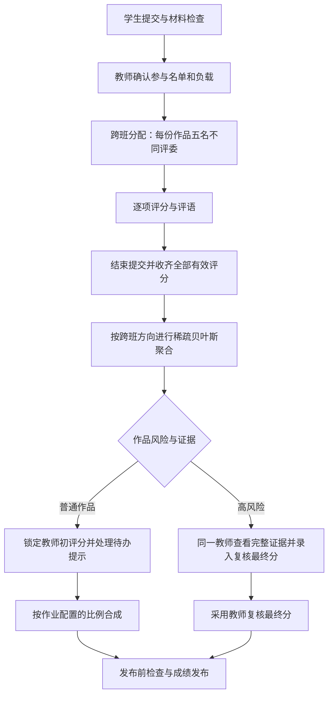

# 算法设计：跨班公平评审与可信成绩

AlgoPeer 的评审由三个相互衔接的算法模块组成：跨班约束随机分配、稀疏贝叶斯评分聚合，以及评分与历史关系异常检测。分配决定谁来评，聚合校准不同学生的评分尺度，异常证据帮助教师完成复核。

## 从作品到成绩



这条流程用于期末微课。编程题使用自动判题；算法分析、证明和开放问答采用在线作答、提交即完成的流程。

## 一、跨班公平随机分配

### 参与范围

期末作业选择两个班。系统根据本次有效作品与参与资格形成名单：1 班学生评 2 班作品，2 班学生评 1 班作品。每名参与学生以当前有效作品进入分配，教师在生成任务前核对名单和工作量。

每份作品安排五名不同评委。同一轮禁止两名作者相互评阅：如果甲被分到乙的作品，乙就不会同时被分到甲的作品。系统同时利用历史配对信息减少重复评阅同一作者。

### 班级人数不同时，怎样计算负担

设 1 班、2 班有效作品数为 `S1、S2`，参与评委数为 `R1、R2`。首次分配的任务总量为：

```text
1 班评委任务总量 = 5 × S2
2 班评委任务总量 = 5 × S1
```

本班学生的任务数限制在本班人均任务数的向下、向上取整之间，因此首次分配的班内任务差最多为 1。

两班分别为 100 人与 40 人，且每人都有一份有效作品并参加评审时：

| 评委班级 | 要评的作品数 | 总任务数 | 每人任务数 |
| --- | ---: | ---: | ---: |
| 1 班，100 人 | 40 | 200 | 2 |
| 2 班，40 人 | 100 | 500 | 12～13 |

这里的公平同时体现为每份作品都得到五份评价、每个班内部的任务尽量均衡。教师在预览中确认两个班的实际负担后启动评审。

### 约束优化与随机性

系统为合法的“评委—作品”配对建立二元选择变量，使用 0–1 混合整数规划同时求解两个方向。硬约束包括每份五评、严格跨班、首次班内负载上下限，以及本轮禁止直接互评。

在满足约束的方案中，优化目标优先减少历史重复配对，再使用固定随机种子生成的小扰动区分同等代价的选择。随机种子、输入快照和最终任务都保存下来，使同一次分配可以复核。

首次求解后，系统还尝试通过合法任务交换改善分散的评阅图结构，交换时保留五评、负载与禁止直接互评约束。共同评过作品的学生为后续评分尺度校准提供参照。

### 人数条件与分配失败

当每名有效提交者既是作者又参加评审时，设两班人数为 `n1、n2`，必要条件为：

```text
min(n1, n2) ≥ 5
5 × (n1 + n2) ≤ n1 × n2
```

第一项保证每份作品有五名跨班候选人。第二项来自禁止直接互评：每一对跨班学生最多承担一个方向的评阅，而所有作品共需 `5 × (n1 + n2)` 条任务。

因此，两班各五人即使都已提交，也无法同时满足每份五评与禁止直接互评；两班各十人满足上述必要条件。最终能否分配，由完整约束求解确定。求解失败会保留诊断，本次任务整批保持未生成状态，教师调整参与情况后可重新预览。

### 提交与评审并行

教师可以在提交截止前启动评审。作品一旦获得任务，当前版本锁定；尚未分配的学生仍可在开放时间内提交或更新作品。

新增有效作品后，教师刷新预览并追加分配。增量算法固定已有任务，只为新作品选评委：

1. 保持每份五评、严格跨班和合并后无直接互评。
2. 优先最小化累计任务量的平方和，使新增任务倾向负担较轻的学生。
3. 再减少历史重复配对，并用固定种子区分同等选择。

增量分配与缺评替补都会记录实际负载。由于已发出的任务被保留，后续班内任务差可能超过 1；预览与运行记录展示当前分布。

## 二、稀疏贝叶斯评分聚合

### 为什么需要校准

五位学生对同一作品打分时，可能有人一贯偏严、有人一贯偏宽，也可能某次分数明显偏离材料与其他评审。模型把作品得分、评分者的稳定严宽倾向、评分波动和单次异常概率一起估计，让教师同时看到聚合结果与评分证据。

“稀疏”表示每名学生只评一部分作品、不同作品的评委组合不同。模型沿着实际发生的评分关系计算，未被分配的位置保持缺失。

两个跨班方向分别建模：1 班作品与 2 班评委构成一个范围，2 班作品与 1 班评委构成另一个范围。教师初评分独立保存，同伴模型使用学生实际提交的评分。

### 模型中的量

| 量 | 含义 |
| --- | --- |
| 作品逐项得分 `theta` | 模型估计的作品在某个评分维度上的归一化得分 |
| 评委偏差 `bias` | 稳定的偏严或偏宽倾向 |
| 评分波动 `sigma` | 该评委分数围绕校准结果的波动程度 |
| 异常倾向 `pi` | 模型中的异常评分先验参数 |
| 单次异常概率 `p` | 某条具体评分在当前模型下的异常后验概率 |

各项原始分先除以该项满分，统一到 0～1。正常评分以作品分加评委偏差为中心，异常部分使用覆盖 0～1 的宽分布。当前实现采用高斯密度与均匀密度的混合近似进行确定性 MAP-EM 更新。

单条评分在逐项估计中的有效权重为：

```text
有效权重 = (1 − 单次异常概率) / max(评分波动², 最小波动²)
```

作品逐项分以带先验的加权结果更新；评委偏差、波动与异常倾向依据该评委实际评过的作品更新。在每个相连的评分图分量内，已学习评委的偏差中心化，形成共同的校准参照。

系统最多迭代 100 次，参数变化小于 `0.000001` 时接受收敛结果。逐项结果换回原满分尺度并保留两位小数，再合成总分。五人原始分和逐项中位数一起保留，便于对照。

### 样本量决定学习方式

评委完成至少三份不同作品后，模型才学习其个人评分参数。只完成一两份作品时，个人参数保持群体先验，页面记录其样本数和学习状态。

例如 100∶40 的首次分配中，大班评委通常每人评两份，使用先验；小班评委每人评 12～13 份，具备学习个人尺度的样本。门槛按不同作品计数，一份作品的多个评分维度仍只算一份。

### 区间与小样本

模型为逐项结果提供近似不确定性区间与置信度指标。区间较宽，表示当前评分证据对结果的约束较弱。指标描述的是模型估计的确定程度。

| 情况 | 处理方式 |
| --- | --- |
| 某作品评分未齐五份 | 等待完成或补评，正式聚合与发布继续被阻断 |
| 某个方向可用作品少于三份 | 使用逐项中位数回退，个人画像保留先验 |
| 小样本回退且五名评委每个维度原始分完全一致 | 保留真实近似区间，该作品豁免“区间宽”这一项高风险触发 |
| 迭代未收敛 | 运行标为失败，保留诊断供重试；失败结果不进入正式成绩 |
| 输入越界、评分项不完整等错误 | 拒绝该运行，先修正评分完整性 |

回退区间以中位数为中心、使用先验噪声计算，结果带有回退标识。教师可根据学习状态、区间来源和实际评分共同解读。

## 三、评分与历史关系异常检测

### 单次评分和作品证据

| 条件 | 当前默认规则 |
| --- | --- |
| 四人接近、单人极端偏离 | 其他四人的归一化跨度 ≤15%，该人偏离其他四人中位数 ≥30% |
| 单次异常后验较高 | 异常后验概率 ≥95% |
| 模型与原始评分中位数冲突 | 逐项差异 ≥该项满分的 15% |
| 结果区间过宽 | 一般判定线为该项满分的 20% |

模型收敛且某一项的全部评委均保持先验画像时，区间宽判定线为 25%，实际区间保持原值。这样与人数不平衡时的样本量相匹配；其余异常规则继续执行。

任一评分维度触发高风险条件，作品进入高风险复核。评阅时长和评语字数保留为客观记录；当前风险计算采用分数异常与评分模式等证据。低熵评分模式保留提示，耗时和评语长度不计入风险分、风险等级或复核依据。

### 历史关系证据

系统结合近期相关作业，分析经过评分尺度校准后的“评委 → 作者”残差关系。每份历史作业只使用最新成功运行，同一次作业的反复重算保持一份历史支持。

当前关系检测使用标准化残差绝对值 2 作为异常证据门槛：

- 同一评委对同一作者，在至少三份不同作业中出现同方向异常残差，形成持续抬分或压分证据。
- 两至四人构成持续正向关系环，且环上关系在至少两份不同作业中得到支持，形成关系环证据。
- 至少三份配对作业中有两份同方向异常，形成集中关系的中风险提示。

教师可以沿提示查看具体作业、评分与支持记录。HIGH 要求最终复核；LOW / MEDIUM 的待处理提示由教师明确确认或驳回。

## 四、成绩怎样形成

### 普通作品

```text
最终分 = 教师权重 × 已锁定教师初评分
       + 同伴权重 × 同伴聚合分
```

两项权重默认 60% / 40%，由教师在作业草稿中设置，合计为 100%，发布作业后冻结。教师 90 分、同伴聚合 80 分时，默认比例得到 86 分，70% / 30% 得到 87 分。

### 高风险作品

同一位教师查看作品材料、第一次教师分、五人原始分、聚合分和异常证据，填写一个复核最终分并锁定：

```text
最终分 = 教师复核最终分
```

教师初评、原始同伴分、算法结果与复核记录分别保留。复核理由选填，系统仍保存操作人、时间与结论。高风险复核完成后，对应 HIGH 待办得到处理；其他待处理提示继续按页面要求完成。

### 发布前检查

正式发布核对提交结束、全部有效作品已分配、每份五份完整有效评分、聚合成功、教师锁分、异常处理以及高风险复核状态。同伴权重设为 0% 时仍保持五份有效评分要求。

最终成绩保存本次分数、权重与来源快照。已发布结果保持固定，导出时可以追溯教师初评、同伴聚合与最终复核来源。

## 五、可复现性与计算规模

每次分配与聚合保存算法版本、参数、随机种子、输入摘要、运行状态和相关证据。任务追加、评分修改、教师更正与最终复核都有独立记录。

若两班分别为 `n1、n2` 人，且每人一份作品，首次分配的候选变量约为 `2 × n1 × n2`；100∶40 对应约 8,000 个变量、700 条实际任务。约束优化使用 SciPy / HiGHS，默认求解时间上限 20 秒，接受最优完成状态。

聚合按实际评分扫描。设任务数为 `M`、评分项数为 `K`、迭代数为 `I`，主迭代时间为 `O(I × M × K)`。历史关系检测使用有界历史窗口与最长四人的关系环搜索。

## 六、论文依据与课程规则

| 来源 | 采用的思想 | AlgoPeer 的落点 |
| --- | --- | --- |
| [PeerReview4All，JMLR 2021](https://jmlr.org/papers/v22/20-190.html) | 公平与准确性相结合的评审分配 | 跨班候选图、工作量约束与分配设计参考 |
| [Randomized Reviewer Assignments，NeurIPS 2020](https://proceedings.neurips.cc/paper/2020/hash/93fb39474c51b8a82a68413e2a5ae17a-Abstract.html) | 用受约束随机分配缓解策略性配对 | 固定种子扰动、合法配对与历史重复控制的设计参考 |
| [Better Peer Grading through Bayesian Inference，AAAI 2023](https://ojs.aaai.org/index.php/AAAI/article/view/25757) | 概率模型中的评分误差、可靠性与低投入行为 | 稀疏评分图上的鲁棒贝叶斯聚合 |

AlgoPeer 将这些思想落实为跨班联合整数约束、确定性 MAP-EM、样本量感知画像学习及教师复核流程。每份五评、权重配置、异常阈值和最终复核方式是平台采用的课程规则。具体公式、默认值和源码入口见[算法实现规格](../algorithm/ALGORITHM_SPEC.md)。
